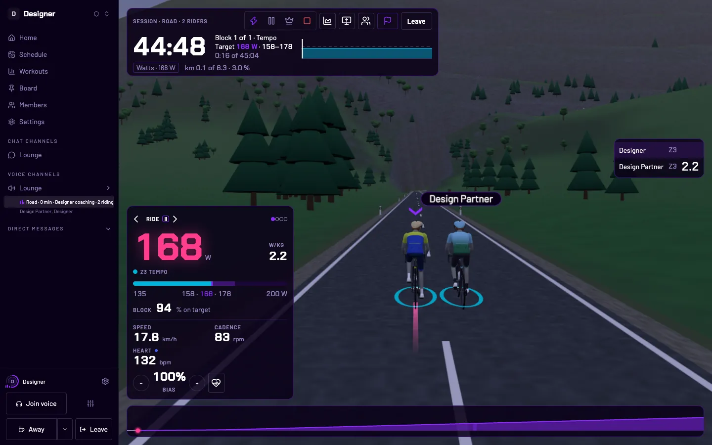
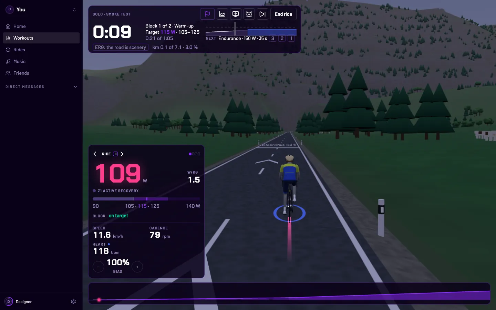
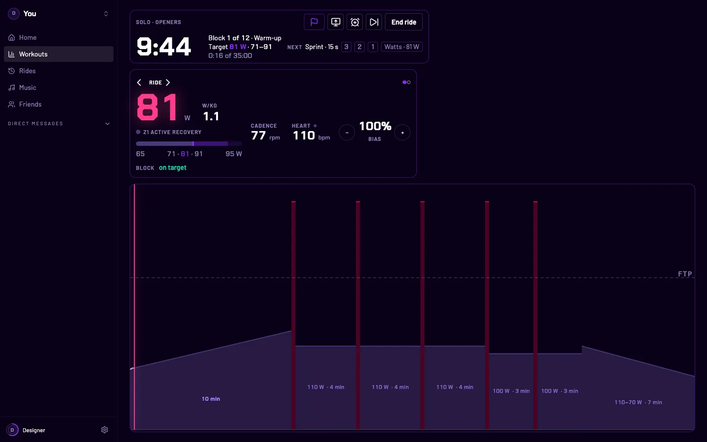
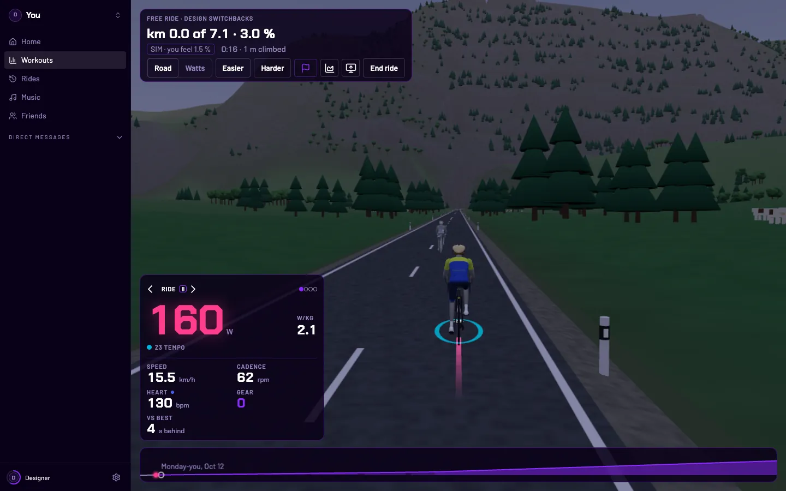
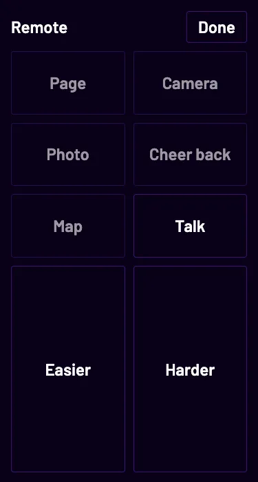
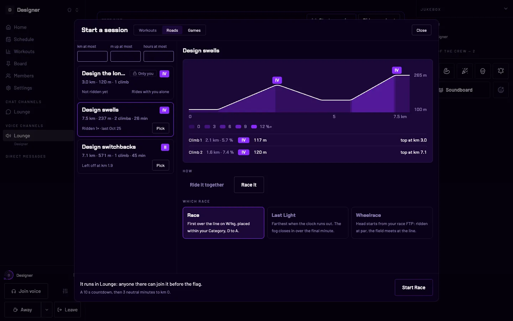
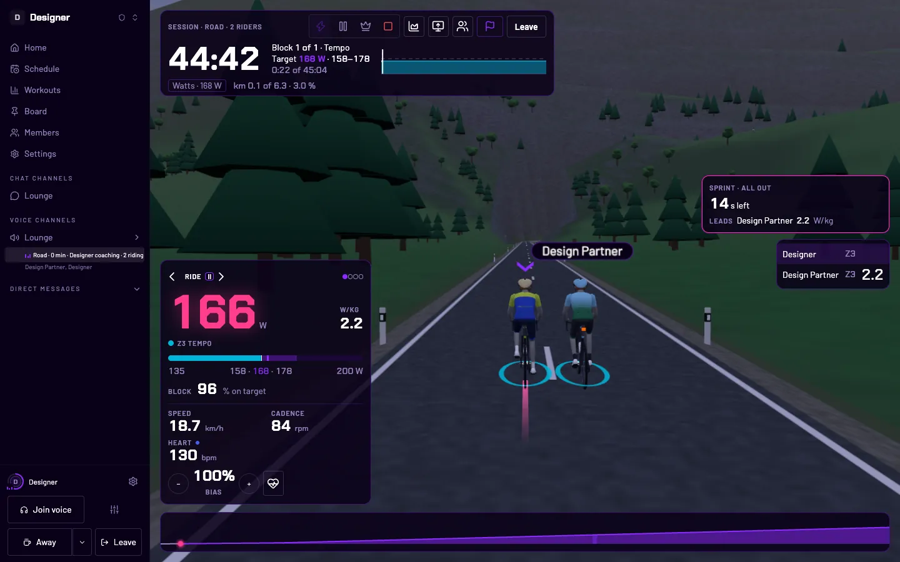
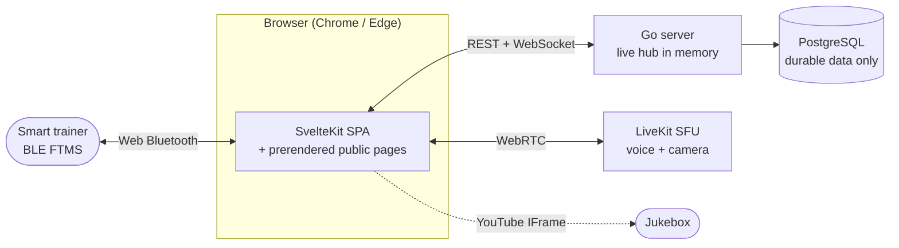

<div align="center">

<a href="https://wattroom.ch"></a>

# WattRoom

**Discord for indoor cycling.** Your crew rides your own roads in a 3D world,
or one structured workout with every smart trainer on its own rider's FTP.
Voice is built in, so you talk the whole way.

**[Ride now at wattroom.ch](https://wattroom.ch)** ·
[Desktop app](https://wattroom.ch/download) ·
[Game modes](https://wattroom.ch/game-modes) ·
[Self-host](https://wattroom.ch/self-host) ·
[Contribute](CONTRIBUTING.md)

[](https://github.com/natrontech/wattroom/releases)
[](https://github.com/natrontech/wattroom/actions/workflows/ci.yml)
[](LICENSE)
[](https://github.com/natrontech/wattroom/stargazers)

</div>



<p align="center"><sub>A crew session on an imported road, in the 3D world.</sub></p>

## Why

Indoor training is boring alone, and riding with friends usually means three
apps: a training app, Discord for voice, and something for music, all
fighting over one headset. Zwift answers boredom with a game world.
WattRoom answers it with **your crew**:

- **A crew that stays.** A crew has chat channels for the week and voice
  channels for ride night, like a Discord server for your pain cave. Anyone
  in the voice channel starts a session: a free ride on a road, a workout, a
  race or a game.
- **Different FTPs, one session.** Workouts are written in percentages of FTP,
  and every trainer holds its own rider's share in ERG mode. The 180 W rider
  and the 320 W rider ride the same intervals side by side, and it hurts both
  of them the same.
- **Talk the whole way.** Voice is one tap, the camera is optional, and the
  crew's jukebox plays in sync for everyone and ducks when someone speaks.
- **Free, in the browser, open source.** Chrome or Edge talks to your trainer
  over Bluetooth. Nothing to install and nothing to pay.

## What's inside

<table>
<tr>
<td width="50%" valign="top">

**Workouts on the road.** Ride a workout on one of your roads and its next
three blocks are painted on the asphalt, each with its name and your target.
A sprint gets a banner across the road from 1 km out.



</td>
<td width="50%" valign="top">

**Or on the graph.** A workout without a road rides on its interval graph,
every block labelled. The library, an editor and `.zwo` and `.erg` import fill
the shelf, and a [free ramp test](https://wattroom.ch/ftp-test) finds your FTP.



</td>
</tr>
<tr>
<td width="50%" valign="top">

**Your ghost.** Ride a road of yours again from its start and the rider you
were last time rides beside you, a see-through figure in your own kit. The
bike computer says the gap in words.



</td>
<td width="50%" valign="top">

**Gears and your phone.** Easier and Harder shift virtual gears on a road,
from the screen, the `−` and `+` keys or a Zwift Cog. Open WattRoom on your
phone while the desk rides and the phone becomes your remote.

<p align="center"></p>

</td>
</tr>
<tr>
<td width="50%" valign="top">

**Races on your roads.** Pick a road in the session picker, tap Race it, and
choose Race, Last Light or Wheelrace. Races run on W/kg, with results by
category on the closing card.



</td>
<td width="50%" valign="top">

**Seven game modes**, decided by watts alone and measured on each rider's
own FTP, so the smallest engine in the crew can win.



</td>
</tr>
</table>

Every ride saves privately, with a `.fit` file to download and one tap to
Strava. Voice and video are never recorded.

### The game modes

| Mode                | How it plays                                                          |
| ------------------- | --------------------------------------------------------------------- |
| **Sprint Roulette** | Five sprints land at random, a klaxon three seconds before each.      |
| **Points Race**     | Two-minute intervals with sprints hidden in them. Every one scores.   |
| **Watt Golf**       | Hit a wattage for ten seconds, with the meter turned off.             |
| **Backyard Ramp**   | Three-minute rounds, +5 % FTP each. Ten seconds below and you're out. |
| **Collective Ramp** | The same, on the crew's average. Nobody gets dropped alone.           |
| **Floor is Lava**   | A power zone is called. Leave it and you burn a life.                 |
| **Team Relay**      | One rider on the front at 110 %, everyone else recovering.            |

Races on a road start from the session picker: Race, Last Light (10, 20 or
30 minutes) and Wheelrace (a par of 15 to 45 minutes). The parameters live in
[docs/spec/game-modes.md](docs/spec/game-modes.md).
You can [try a sprint on the website](https://wattroom.ch/game-modes).

> [!NOTE]
> **Hardware and browsers.** WattRoom needs a smart trainer that speaks **Bluetooth FTMS**, which most current trainers do. Pre-FTMS Wahoo units are [not supported yet](https://github.com/natrontech/wattroom/issues/4). It also needs **Chrome or Edge** on Windows, macOS or Android, or the [desktop app](https://wattroom.ch/download). On Linux, Chrome keeps Web Bluetooth behind a flag. Safari and Firefox cannot reach a trainer, so iPhone and iPad riders can join the crew and the call but not ride. That is a [researched decision](docs/decisions/0004-chrome-first-with-native-escape-hatch.md), not an oversight.

## How it compares

|                              | WattRoom                          | Zwift          | TrainerRoad           | MyWhoosh                 |
| ---------------------------- | --------------------------------- | -------------- | --------------------- | ------------------------ |
| Price                        | Free                              | US$19.99/mo    | US$21.99/mo per rider | Free                     |
| One workout, each on own FTP | ✓ anyone in the channel starts it | ✓ via a Meetup | ✓ up to 11 riders     | pacer-led group workouts |
| Voice built in               | ✓                                 | text chat      | ✓ voice and video     | text chat                |
| 3D world                     | your own roads                    | ✓              | none                  | ✓                        |
| Runs in a browser            | ✓                                 | –              | –                     | –                        |
| Open source                  | ✓ AGPL                            | –              | –                     | –                        |

Checked September 2026. There are sources and a "pick them if…" for each on [wattroom.ch/zwift-alternative](https://wattroom.ch/zwift-alternative). We make WattRoom, so check for yourself.

## Run it

- **Hosted, free:** [wattroom.ch](https://wattroom.ch). Start a crew and send the code.
- **Desktop app** for macOS, Windows and Linux: [wattroom.ch/download](https://wattroom.ch/download).
- **Your own server:** one Go binary with the web app embedded, Postgres and
  LiveKit, all in one Docker Compose stack on a small VM.

<details>
<summary><b>Self-host in five minutes</b></summary>

```sh
mkdir -p /opt/wattroom && cd /opt/wattroom
# copy this repository's deploy/ directory here
cp .env.example .env                    # every value is explained inside
cp livekit.yaml.example livekit.yaml    # same keys as .env
docker compose -f docker-compose.prod.yml up -d
```

Releases are CalVer tags (`ghcr.io/natrontech/wattroom:2026.09.1`). An update
is a tag bump, and a rollback is the previous tag: migrations only ever add
([ADR-0019](docs/decisions/0019-tagged-releases-and-a-self-converging-vm.md)).
The full guide, including how LiveKit reaches the server and what to back up,
is in [deploy/README.md](deploy/README.md).

</details>

## Develop

Requirements: Go 1.26+, Node 22+, pnpm, Docker. The pnpm version is pinned in
`web/package.json` (`packageManager`), and a global pnpm 12 or corepack installs it
for you (pnpm 10 fails the switch with `ENOEXEC`: CONTRIBUTING.md).

```sh
make infra        # Postgres + LiveKit (dev mode) in containers
make dev-server   # terminal 1: Go server with hot reload on :8080
make dev-web      # terminal 2: Vite dev server on :5174 (proxies /api + /ws)
```

No smart trainer needed: the simulated trainer covers development, and
`/dev/channel` is a full mock voice channel. `make site-screens` redraws the
screenshots in this README and on the landing from the design shots, and
`make screenshots` redraws the share cards and the other pages' screenshots
from the running dev pair. Start with
[CONTRIBUTING.md](CONTRIBUTING.md); every product and architecture decision is
in [WATTROOM.md](WATTROOM.md) and [docs/decisions/](docs/decisions/).



The seams are deliberate. The browser owns the trainer, the server owns live
state in memory, and Postgres owns only what has to last
([docs/ARCHITECTURE.md](docs/ARCHITECTURE.md)). WattRoom ships several times a
day: a release only ever adds a small, merged change, and rolling back means
repointing the image at the previous tag.

## License

[AGPL-3.0](LICENSE), © [Natron](https://natron.io), built in Switzerland. If WattRoom
made a Tuesday night better, [star the repo](https://github.com/natrontech/wattroom/stargazers).
It helps other pain-cave dwellers find it.
